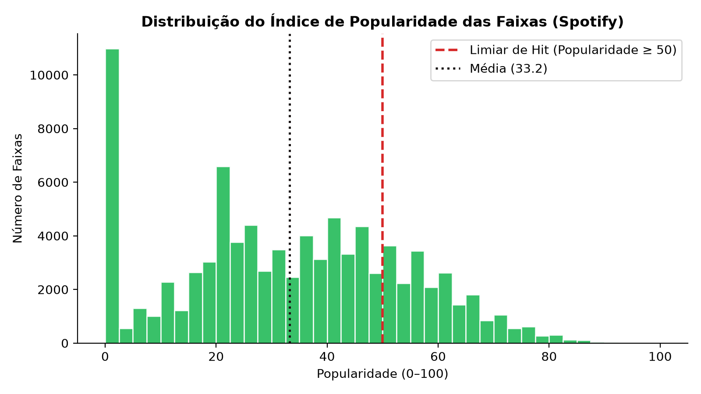
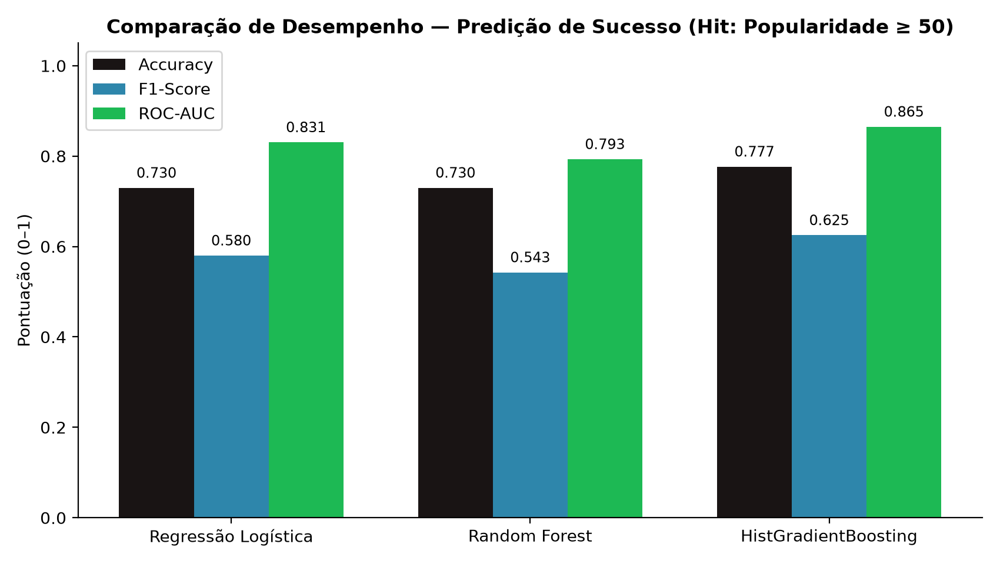
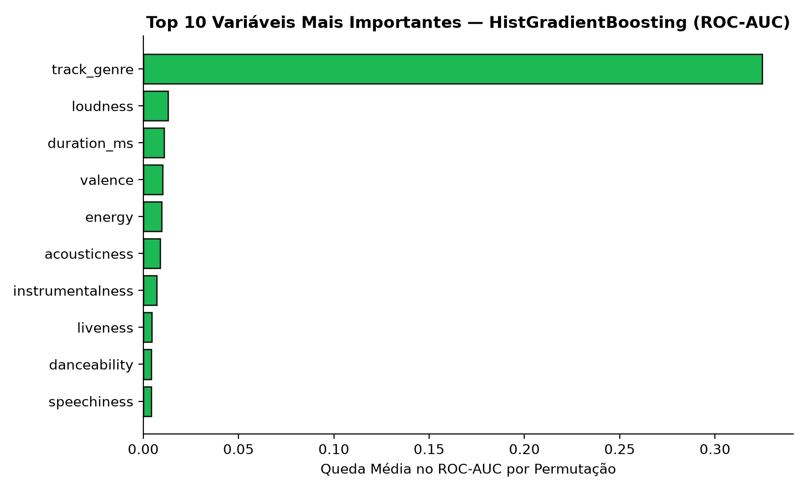
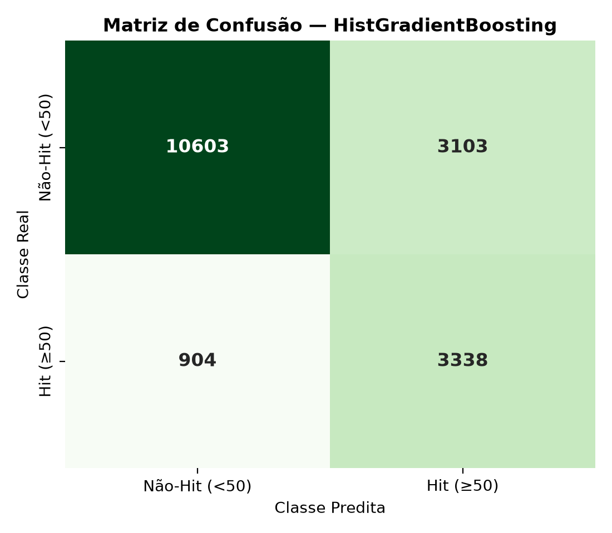

# Spotify Hit & Genre Intelligence

Sistema de Ciência de Dados e Aprendizado de Máquina aplicado ao **Spotify Tracks Dataset** para predição de popularidade musical, detecção de potenciais *hits* e classificação automática de gêneros a partir de atributos acústicos.

## Autores (Dupla)

| Nome | Prontuário |
| :--- | :--- |
| **Vinícius Francisco Garcia Sobral** | `cg3034241` |
| **Arthur de Morais Marques** | `cg3033856` |

## Links Públicos das Entregas

- **Repositório GitHub:** [https://github.com/vinikyo/spotify-hit-intelligence](https://github.com/vinikyo/spotify-hit-intelligence)
- **Hub Público (GitHub Pages):** [https://vinikyo.github.io/spotify-hit-intelligence/](https://vinikyo.github.io/spotify-hit-intelligence/)
- **Pitch Interativo (Slides Públicos):** [https://vinikyo.github.io/spotify-hit-intelligence/pitch/](https://vinikyo.github.io/spotify-hit-intelligence/pitch/) | [Roteiro em Markdown](pitch/PITCH.md)
- **Artigo Científico (Web / Exportável em PDF):** [https://vinikyo.github.io/spotify-hit-intelligence/artigo/](https://vinikyo.github.io/spotify-hit-intelligence/artigo/) | [Artigo em Markdown](artigo/artigo_cientifico.md)
- **Documento Consolidado da Atividade:** [`docs/entrega_atividade.md`](docs/entrega_atividade.md)
- **Dicionário de Dados Completo:** [`docs/dicionario_dados.md`](docs/dicionario_dados.md)

---

## Conjunto de Dados (*Dataset*)

- **Dataset utilizado:** Spotify Tracks Dataset (Maharshi Pandya)
- **URL Pública (Kaggle):** [https://www.kaggle.com/datasets/maharshipandya/-spotify-tracks-dataset](https://www.kaggle.com/datasets/maharshipandya/-spotify-tracks-dataset)
- **URL de Download Direto (Espelho Público Hugging Face):** [https://huggingface.co/datasets/maharshipandya/spotify-tracks-dataset/resolve/main/dataset.csv](https://huggingface.co/datasets/maharshipandya/spotify-tracks-dataset/resolve/main/dataset.csv)
- **Dimensões:** 114.000 registros brutos → **89.740 faixas únicas** após limpeza e deduplicação por `track_id`, com 20 atributos e 114 gêneros musicais.

---

## Descrição do Sistema (Máximo de 200 Palavras)

O **Spotify Hit & Genre Intelligence** é um sistema analítico e preditivo baseado em Aprendizado de Máquina, desenvolvido para apoiar gravadoras, produtores musicais, curadores de playlists e artistas independentes na tomada de decisão orientada por dados. A partir do *Spotify Tracks Dataset* (114.000 faixas e atributos acústicos extraídos via Spotify Web API, como dançabilidade, energia, valência, volume, andamento e duração), o sistema executa um pipeline automatizado de pré-processamento, análise exploratória e modelagem supervisionada. Seu funcionamento organiza-se em três frentes complementares: (1) regressão para estimar o índice contínuo de popularidade (`popularity`, de 0 a 100); (2) classificação binária para identificar faixas com alto potencial comercial (*hits*, com `popularity >= 50`); e (3) classificação multiclasse para reconhecer automaticamente o gênero musical (`track_genre`) apenas pelas características sonoras. Os algoritmos avaliados — Regressão Linear/Logística, Random Forest e HistGradientBoosting — são comparados por métricas padronizadas (RMSE, MAE, R², F1-Score e ROC-AUC), gerando diagnósticos visuais de correlação e importância de variáveis. Dessa forma, o sistema traduz sinais acústicos complexos em recomendações práticas para curadoria, catalogação automática e estratégia de lançamento musical.

---

## Objetivos do Sistema (*Targets*) e Principais Resultados

| Tarefa | Variável-Alvo (*Target*) | Melhor Algoritmo | Desempenho no Teste |
| :--- | :--- | :--- | :--- |
| **Regressão Contínua** | `popularity` (`0–100`) | Random Forest Regressor | **R² = 0,4394** · RMSE = 15,316 · MAE = 10,893 |
| **Classificação Binária (*Hits*)** | `is_hit` (`popularity >= 50`) | HistGradientBoosting | **ROC-AUC = 0,8649** · Acc = 77,67% · Recall = 78,69% · F1 = 0,6249 |
| **Classificação Multiclasse** | `track_genre` (10 gêneros, só áudio) | Random Forest Classifier | **Acc = 66,03%** · F1-Macro = 0,6632 (vs. 10% acaso) |

### Visualizações Geradas pelo Pipeline

| Distribuição de Popularidade | Comparação de Modelos (*Hits*) |
| :---: | :---: |
|  |  |

| Importância de Variáveis (ROC-AUC) | Matriz de Confusão (HistGradientBoosting) |
| :---: | :---: |
|  |  |

---

## Estrutura do Repositório

```text
├── artigo/
│   ├── artigo_cientifico.md        # Artigo científico completo em Markdown
│   └── index.html                  # Versão acadêmica Web / exportável para PDF
├── docs/
│   ├── dicionario_dados.md         # Dicionário completo das 20+ variáveis do dataset
│   └── entrega_atividade.md        # Documento consolidado pronto para entrega
├── pitch/
│   ├── index.html                  # Slides interativos do Pitch (10 slides)
│   └── PITCH.md                    # Roteiro textual de apresentação
├── results/
│   ├── metrics.json                # Métricas reais geradas pelo pipeline
│   └── figures/                    # 6 gráficos em alta resolução (EDA e ML)
├── src/
│   ├── download_data.py            # Download automático do dataset público
│   └── pipeline.py                 # Pipeline completo de limpeza, EDA e ML
├── index.html                      # Hub público (GitHub Pages)
├── requirements.txt                # Dependências Python
└── README.md
```

## Como Reproduzir os Experimentos

```bash
# 1. Criar ambiente virtual e instalar dependências
python -m venv .venv
.\.venv\Scripts\activate      # Windows (ou source .venv/bin/activate no Linux/macOS)
pip install -r requirements.txt

# 2. Baixar o dataset público (Spotify Tracks Dataset)
python src/download_data.py

# 3. Executar o pipeline completo de EDA e Machine Learning
python src/pipeline.py
```
