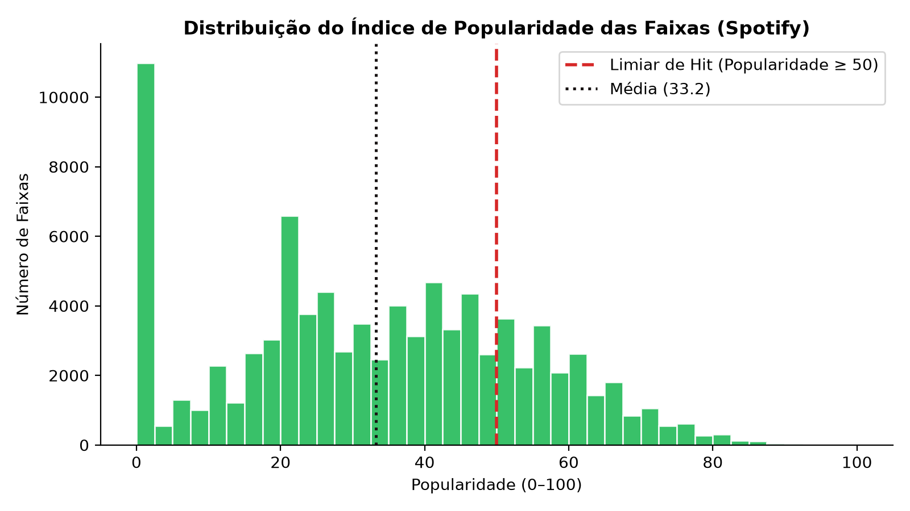
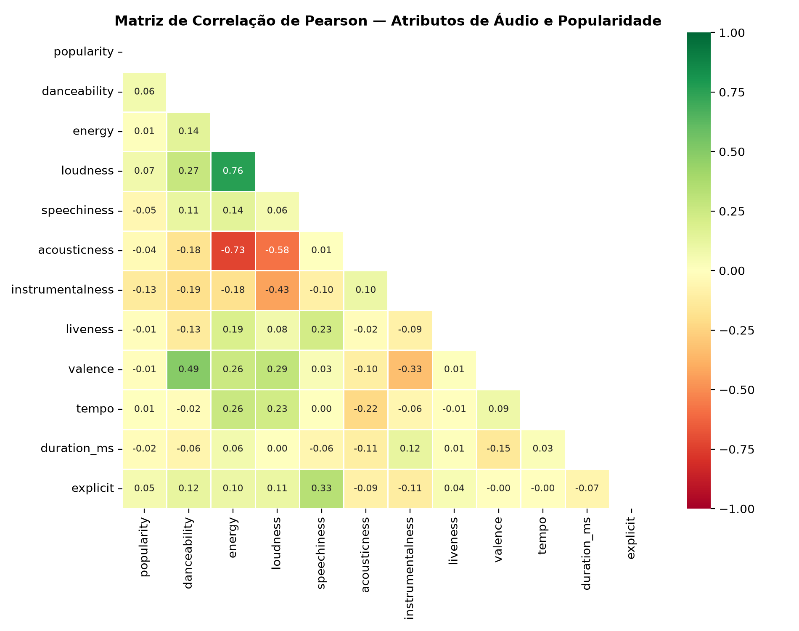
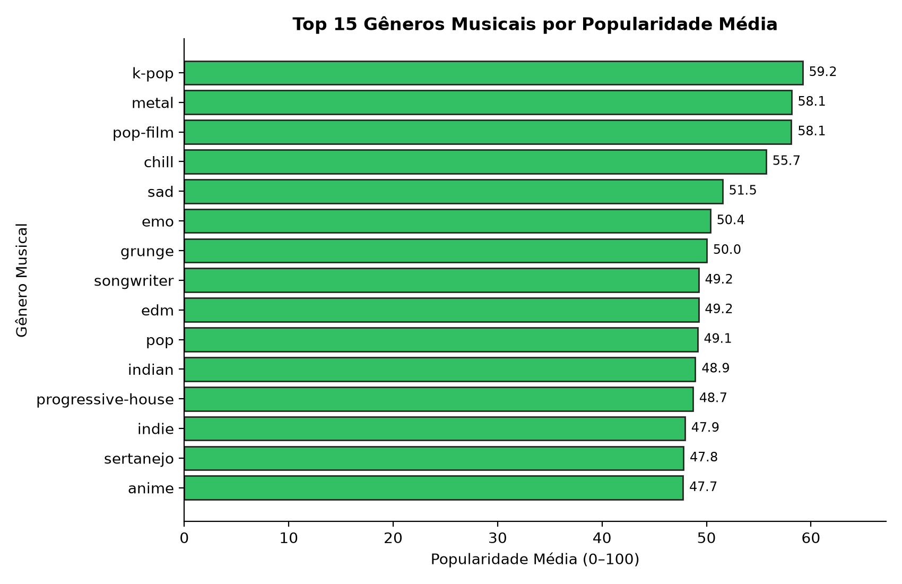
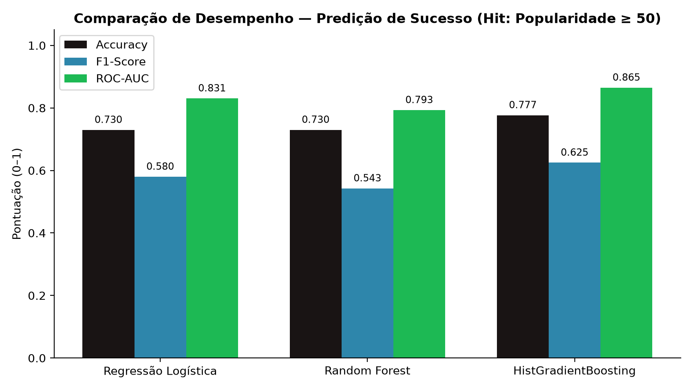
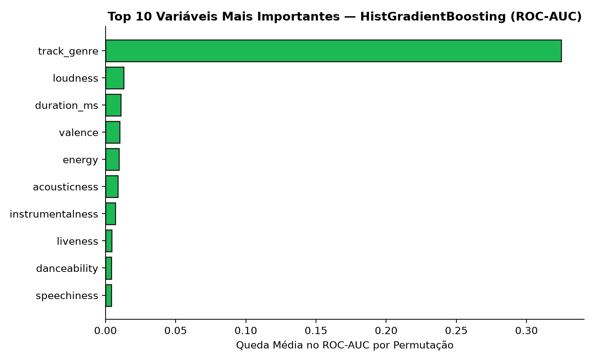
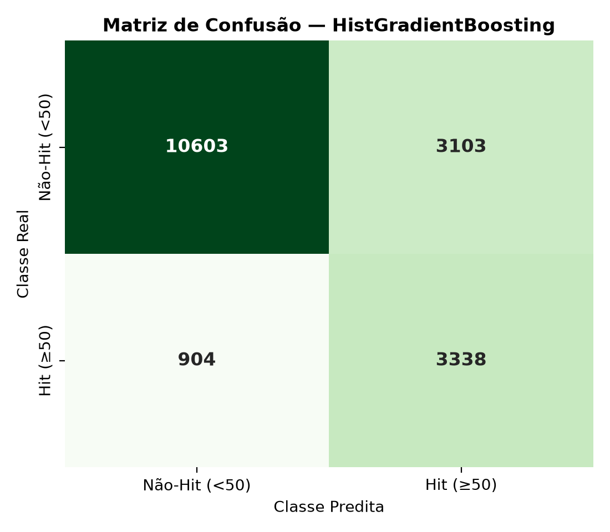

# Predição de Popularidade e Classificação de Gêneros Musicais no Spotify por Meio de Aprendizado de Máquina

**Vinícius Francisco Garcia Sobral** (Prontuário: `cg3034241`)  
**Arthur de Morais Marques** (Prontuário: `cg3033856`)  
Instituto Federal de Educação, Ciência e Tecnologia de São Paulo (IFSP)  
Repositório do Projeto: [https://github.com/vinikyo/spotify-hit-intelligence](https://github.com/vinikyo/spotify-hit-intelligence)

---

## Resumo

O crescimento exponencial das plataformas de *streaming* musical transformou radicalmente a indústria fonográfica, gerando catálogos com dezenas de milhões de faixas e ampliando a disputa pela atenção dos ouvintes. Nesse cenário, compreender quais atributos acústicos e estruturais influenciam o desempenho comercial de uma música torna-se estratégico para gravadoras, produtores e artistas independentes. Este trabalho apresenta o sistema **Spotify Hit & Genre Intelligence**, um pipeline reproduzível de Ciência de Dados e Aprendizado de Máquina aplicado ao *Spotify Tracks Dataset* (114.000 registros originais e 89.740 faixas únicas após deduplicação, distribuídas em 114 gêneros musicais). Foram investigadas três tarefas supervisionadas complementares: (i) regressão do índice contínuo de popularidade (`popularity`), (ii) classificação binária de faixas de alto sucesso comercial (`is_hit`, definido por `popularity >= 50`) e (iii) classificação multiclasse de gênero musical (`track_genre`) em 10 gêneros representativos utilizando exclusivamente atributos acústicos. Os resultados experimentais demonstram que relações não lineares dominam o fenômeno: na regressão, o *Random Forest Regressor* atingiu $R^2 = 0{,}4394$ e $\text{RMSE} = 15{,}316$ (superando em 11,1 pontos percentuais a Regressão Ridge); na predição de *hits*, o *HistGradientBoosting* alcançou $\text{ROC-AUC} = 0{,}8649$, acurácia de $77{,}67\%$ e revocação de $78{,}69\%$; e na classificação de gêneros, o *Random Forest* obteve acurácia de $66{,}03\%$ ($\text{F1-Macro} = 0{,}6632$). A análise de importância por permutação evidenciou que o gênero musical, seguido por volume (`loudness`), duração (`duration_ms`), valência (`valence`) e energia (`energy`), são os principais determinantes preditivos.

**Palavras-chave:** Aprendizado de Máquina; Spotify; Predição de Popularidade; Classificação de Gêneros Musicais; Ciência de Dados; *Hit Song Science*.

---

## Abstract

The rapid expansion of music streaming platforms has fundamentally reshaped the phonographic industry, producing catalogs with tens of millions of tracks and intensifying competition for listener attention. Understanding which acoustic and structural attributes drive commercial performance is therefore critical for record labels, producers, and independent artists. This paper introduces **Spotify Hit & Genre Intelligence**, a reproducible Data Science and Machine Learning pipeline applied to the *Spotify Tracks Dataset* (114,000 raw entries and 89,740 unique tracks after deduplication across 114 musical genres). Three complementary supervised tasks were evaluated: (i) continuous popularity regression (`popularity`), (ii) binary hit prediction (`is_hit`, defined as `popularity >= 50`), and (iii) multiclass genre classification (`track_genre`) across 10 representative genres using solely audio features. Experimental results confirm that non-linear interactions govern track performance: for regression, Random Forest achieved $R^2 = 0.4394$ and $\text{RMSE} = 15.316$ (outperforming Ridge Regression by 11.1 percentage points); for hit prediction, HistGradientBoosting reached $\text{ROC-AUC} = 0.8649$, $77.67\%$ accuracy, and $78.69\%$ recall; and for genre classification, Random Forest achieved $66.03\%$ accuracy ($\text{Macro-F1} = 0.6632$). Permutation importance analysis revealed that musical genre, followed by loudness, duration, valence, and energy, are the primary predictive drivers.

**Keywords:** Machine Learning; Spotify; Popularity Prediction; Music Genre Classification; Data Science; Hit Song Science.

---

## 1. Introdução

Nas últimas duas décadas, o consumo de música migrou de mídias físicas e downloads digitais para plataformas de *streaming* sob demanda, como Spotify, Apple Music e Deezer. De acordo com relatórios recentes da indústria fonográfica, mais de 100 mil novas faixas são carregadas diariamente nos serviços de *streaming*, criando um ambiente hipercompetitivo no qual a descoberta orgânica de novos artistas é um desafio constante.

Dentro da área conhecida na literatura como *Hit Song Science* (HSS), pesquisadores buscam investigar até que ponto características intrínsecas do sinal de áudio — como dançabilidade, energia, valência emocional, andamento (BPM), volume e instrumentalidade — conseguem explicar ou antecipar o sucesso comercial de uma música. Embora fatores externos (marketing, fama prévia do artista, viralização em redes sociais e inserção em playlists editoriais) desempenhem papel relevante, os atributos acústicos fornecidos pela Spotify Web API constituem uma base objetiva, escalável e disponível antes mesmo do lançamento oficial de uma faixa.

Neste contexto, o presente trabalho tem como objetivo projetar, implementar e avaliar um sistema completo de análise e predição musical denominado **Spotify Hit & Genre Intelligence**. Especificamente, busca-se responder a três questões de pesquisa:

1. **QP1 (Regressão de Popularidade):** Com qual precisão modelos lineares e baseados em árvores conseguem estimar o índice contínuo de popularidade (`popularity`, de 0 a 100) de uma faixa?
2. **QP2 (Identificação de *Hits*):** É possível classificar com alto poder discriminativo (ROC-AUC) se uma faixa atingirá o patamar de sucesso comercial (`popularity >= 50`) a partir de seus atributos acústicos e gênero?
3. **QP3 (Reconhecimento Acústico de Gêneros):** Apenas as características sonoras extraídas do áudio são suficientes para distinguir automaticamente o gênero musical (`track_genre`) entre 10 grandes estilos musicais?

---

## 2. Referencial Teórico e Trabalhos Relacionados

A interseção entre Recuperação de Informação Musical (*Music Information Retrieval* — MIR) e Aprendizado de Máquina tem sido amplamente explorada. Pachet e Roy (2008) introduziram discussões seminais sobre os limites da *Hit Song Science*, questionando se modelos lineares simples seriam capazes de capturar o gosto musical coletivo. Posteriormente, trabalhos como o de Interiano et al. (2018), publicado na *Royal Society Open Science*, analisaram décadas de paradas musicais britânicas e demonstraram tendências consistentes nos atributos acústicos de sucessos comerciais — como redução da instrumentalidade, maior compressão de volume (*loudness*) e padrões específicos de dançabilidade e valência.

Na vertente de classificação automática de gêneros musicais, Tzanetakis e Cook (2002) estabeleceram as bases para a extração de características espectrais e rítmicas aplicadas a classificadores estatísticos. Estudos mais recentes utilizando dados da Spotify Web API confirmam que algoritmos de *ensemble* baseados em árvores de decisão — como *Random Forest* (Breiman, 2001) e *Gradient Boosting* baseado em histogramas (Ke et al., 2017) — superam consistentemente modelos lineares devido à natureza multimodal e não linear das interações entre atributos acústicos (por exemplo, alta energia favorece popularidade em música eletrônica e metal, mas comporta-se de maneira oposta em música clássica e *chill*).

---

## 3. Materiais e Métodos

### 3.1 Conjunto de Dados (*Dataset*)

Utilizou-se o **Spotify Tracks Dataset**, disponibilizado publicamente por Maharshi Pandya no Kaggle (`https://www.kaggle.com/datasets/maharshipandya/-spotify-tracks-dataset`, com espelho direto em `https://huggingface.co/datasets/maharshipandya/spotify-tracks-dataset`). O conjunto bruto contém **114.000 registros** e **20 atributos** úteis (além da coluna de índice `Unnamed: 0`), contemplando **114 gêneros musicais** distintos.

As variáveis abrangem metadados (`track_id`, `artists`, `album_name`, `track_name`, `track_genre`), a métrica de desempenho (`popularity`, de 0 a 100) e 14 atributos acústicos/estruturais (`duration_ms`, `explicit`, `danceability`, `energy`, `key`, `loudness`, `mode`, `speechiness`, `acousticness`, `instrumentalness`, `liveness`, `valence`, `tempo` e `time_signature`). O dicionário completo encontra-se documentado em `docs/dicionario_dados.md`.

### 3.2 Pré-processamento e Limpeza dos Dados

Durante a auditoria inicial do conjunto de dados, identificaram-se dois aspectos críticos que poderiam introduzir vazamento de dados (*data leakage*) caso ignorados:

1. **Valores ausentes:** Foram detectados 3 valores nulos nas colunas textuais de metadados (`artists`, `album_name` e `track_name`), prontamente removidos.
2. **Faixas duplicadas em múltiplos gêneros:** Das 114.000 linhas originais, apenas **89.741** possuíam `track_id` único, pois uma mesma música frequentemente aparece catalogada em mais de um gênero no Spotify. Para evitar que a mesma faixa figurasse simultaneamente nos conjuntos de treino e teste, realizou-se a deduplicação por `track_id`, mantendo o registro de maior popularidade.

Após a limpeza, o conjunto final consolidou **89.740 faixas únicas** (remoção de 24.260 duplicatas/nulos). A variável booleana `explicit` foi convertida para formato binário (`0`/`1`) e criou-se o alvo derivado `is_hit = 1` se `popularity >= 50` e `0` caso contrário.

### 3.3 Definição dos Objetivos (Targets) e Protocolo Experimental

O pipeline experimental foi implementado em Python 3.14 com `scikit-learn`, adotando semente aleatória fixa (`random_state = 42`) e particionamento **80% treino / 20% teste** (com estratificação nas tarefas de classificação):

- **Target 1 — Regressão (`popularity`):** Predição do escore contínuo (0–100) usando os 14 atributos acústicos + `track_genre`. Modelos avaliados: *Ridge Regression* (com *StandardScaler* e *One-Hot Encoding*), *Random Forest Regressor* e *HistGradientBoosting Regressor*. Métricas: RMSE, MAE e $R^2$.
- **Target 2 — Classificação Binária (`is_hit`):** Predição de sucesso comercial (`popularity >= 50`, correspondente a 21.210 faixas ou $23{,}63\%$ da base) com balanceamento de classes (`class_weight="balanced"`). Modelos avaliados: *Regressão Logística*, *Random Forest Classifier* e *HistGradientBoosting Classifier*. Métricas: Acurácia, Precisão, Revocação (*Recall*), F1-Score e ROC-AUC.
- **Target 3 — Classificação Multiclasse (`track_genre`):** Classificação entre 10 gêneros musicais representativos (`classical`, `hip-hop`, `metal`, `pop`, `jazz`, `electronic`, `acoustic`, `reggaeton`, `country`, `rock`, totalizando 7.077 faixas únicas) usando **exclusivamente** os 14 atributos acústicos (sem nenhum metadado textual). Métricas: Acurácia e F1-Macro.

---

## 4. Resultados e Discussão

### 4.1 Análise Exploratória de Dados (EDA)

A análise descritiva das 89.740 faixas únicas revelou popularidade média de **33,21** (desvio padrão de **20,57**, mediana de **33,0**), duração média de **3,82 minutos** e proporção de **8,58%** de faixas com conteúdo explícito. Observou-se ainda um pico expressivo de **10,42%** de faixas com popularidade igual a zero — fenômeno típico de catálogos de cauda longa (*long tail*) no *streaming*.

  
*Figura 1: Distribuição do índice de popularidade das 89.740 faixas únicas e demarcação do limiar de sucesso comercial (Hit ≥ 50).*

A matriz de correlação linear de Pearson (Figura 2) demonstrou correlações individuais modestas entre atributos acústicos isolados e popularidade: os maiores coeficientes positivos foram `loudness` ($r = +0{,}0717$), `danceability` ($r = +0{,}0643$) e `explicit` ($r = +0{,}0548$), enquanto a correlação negativa mais acentuada foi `instrumentalness` ($r = -0{,}1276$), indicando que faixas puramente instrumentais tendem a alcançar menor popularidade média no *mainstream*. Por outro lado, observaram-se fortes correlações estruturais entre os próprios atributos de áudio (como `energy` e `loudness`, e relação inversa entre `energy` e `acousticness`).

  
*Figura 2: Matriz de correlação de Pearson entre os atributos de áudio e a popularidade.*

Em contraste com as correlações lineares fracas das variáveis isoladas, a segmentação por gênero (Figura 3) revelou disparidades acentuadas: gêneros como `k-pop` (média 59,19), `metal` (58,13), `pop-film` (58,12), `chill` (55,71) e `sad` (51,53) lideram o engajamento, enquanto nichos específicos como `iranian` (2,22), `romance` (3,55) e `detroit-techno` (11,17) apresentam médias muito inferiores.

  
*Figura 3: Top 15 gêneros musicais por popularidade média na base limpa.*

### 4.2 Resultados — Target 1: Regressão de Popularidade (`popularity`)

A Tabela 1 apresenta o desempenho dos modelos de regressão no conjunto de teste ($n = 17.948$ faixas).

| Modelo | RMSE | MAE | $R^2$ |
| :--- | :---: | :---: | :---: |
| Ridge Regression | 16,759 | 11,972 | 0,3288 |
| HistGradientBoosting Regressor | 15,558 | **10,871** | 0,4216 |
| **Random Forest Regressor** | **15,316** | 10,893 | **0,4394** |

O *Random Forest Regressor* obteve o melhor coeficiente de determinação ($R^2 = 0{,}4394$) e o menor RMSE ($15{,}316$), superando a *Ridge Regression* em **11,06 pontos percentuais** de variância explicada. Esse ganho confirma que a relação entre características musicais e popularidade é substancialmente não linear.

### 4.3 Resultados — Target 2: Classificação de *Hits* (`is_hit`)

A Tabela 2 e a Figura 4 comparam os classificadores treinados para identificar faixas com `popularity >= 50`.

| Modelo | Acurácia | Precisão | Revocação (*Recall*) | F1-Score | ROC-AUC |
| :--- | :---: | :---: | :---: | :---: | :---: |
| Regressão Logística | 72,97% | 0,4583 | **0,7897** | 0,5800 | 0,8305 |
| Random Forest | 72,99% | 0,4524 | 0,6780 | 0,5427 | 0,7931 |
| **HistGradientBoosting** | **77,67%** | **0,5182** | 0,7869 | **0,6249** | **0,8649** |

O algoritmo **HistGradientBoosting** destacou-se como o melhor modelo global, atingindo **ROC-AUC de 0,8649**, acurácia de **77,67%** e F1-Score de **0,6249**, capturando **78,69%** de todos os *hits* reais do conjunto de teste (Figura 6).

  
*Figura 4: Comparação de desempenho (Acurácia, F1-Score e ROC-AUC) na tarefa de predição de Hits.*

A análise de importância de atributos por permutação sobre o melhor modelo (Figura 5) revelou que `track_genre` é o fator mais determinante (queda média de $0{,}3248$ no ROC-AUC quando permutado), seguido pelos atributos acústicos `loudness` ($0{,}0130$), `duration_ms` ($0{,}0109$), `valence` ($0{,}0102$), `energy` ($0{,}0095$), `acousticness` ($0{,}0088$) e `instrumentalness` ($0{,}0070$).

  
*Figura 5: Top 10 variáveis mais importantes por permutação (métrica ROC-AUC) no modelo HistGradientBoosting.*

  
*Figura 6: Matriz de confusão do modelo HistGradientBoosting no conjunto de teste ($n = 17.948$).*

### 4.4 Resultados — Target 3: Classificação Multiclasse de Gêneros (`track_genre`)

A Tabela 3 apresenta o desempenho na classificação de 10 gêneros distintos utilizando exclusivamente os 14 atributos numéricos de áudio (linha de base aleatória = $10{,}0\%$).

| Modelo | Acurácia | F1-Macro |
| :--- | :---: | :---: |
| Regressão Logística | 47,18% | 0,4714 |
| HistGradientBoosting | 63,35% | 0,6340 |
| **Random Forest** | **66,03%** | **0,6632** |

O *Random Forest* atingiu **66,03% de acurácia** e **0,6632 de F1-Macro**, mais de 6,6 vezes acima do acaso e quase 19 pontos percentuais superior ao modelo linear, comprovando que a assinatura acústica de cada faixa carrega informação altamente discriminativa para catalogação automática de gêneros.

---

## 5. Limitações e Trabalhos Futuros

Embora o sistema tenha alcançado resultados sólidos (ROC-AUC de 0,8649 na predição de *hits*), a variância não explicada na regressão ($1 - R^2 \approx 56\%$) evidencia que o sucesso musical depende também de variáveis exógenas ausentes no conjunto de dados atual, tais como histórico de seguidores do artista, investimento em marketing, data de lançamento, viralização em plataformas de vídeo curto (TikTok/Reels) e inclusão em playlists editoriais.

Como trabalhos futuros, propõe-se: (i) enriquecer o pipeline com metadados temporais e de popularidade histórica do artista via API oficial do Spotify; (ii) incorporar *embeddings* de áudio bruto (espectrogramas Mel) por meio de Redes Neurais Convolucionais (CNNs); e (iii) disponibilizar o modelo treinado em uma interface web interativa para simulação de lançamentos por produtores independentes.

---

## 6. Conclusão

Este trabalho apresentou o desenvolvimento completo e reproduzível do sistema **Spotify Hit & Genre Intelligence**, aplicando técnicas de Ciência de Dados e Aprendizado de Máquina sobre 89.740 faixas únicas do *Spotify Tracks Dataset*. Os experimentos comprovaram que modelos baseados em árvores com interações não lineares (*HistGradientBoosting* e *Random Forest*) superam significativamente abordagens lineares tanto na estimativa de popularidade quanto na detecção de *hits* ($\text{ROC-AUC} = 0{,}8649$) e na classificação automática de gêneros musicais ($66{,}03\%$ de acurácia em 10 classes). Os resultados validam a aplicabilidade prática do sistema como ferramenta de apoio à decisão para curadoria de playlists, catalogação automatizada e planejamento estratégico no mercado de *streaming* musical.

---

## Referências

1. BREIMAN, L. Random Forests. **Machine Learning**, v. 45, n. 1, p. 5–32, 2001.
2. INTERIANO, M. et al. Musical trends and predictability of success in contemporary songs in and out of the top charts. **Royal Society Open Science**, v. 5, n. 5, p. 171274, 2018.
3. KE, G. et al. LightGBM: A Highly Efficient Gradient Boosting Decision Tree. In: **Advances in Neural Information Processing Systems (NeurIPS)**, v. 30, 2017.
4. PACHET, F.; ROY, P. Hit Song Science Is Not Yet a Science. In: **Proceedings of the 9th International Conference on Music Information Retrieval (ISMIR)**, p. 355–360, 2008.
5. PANDYA, M. **Spotify Tracks Dataset**. Kaggle, 2022. Disponível em: <https://www.kaggle.com/datasets/maharshipandya/-spotify-tracks-dataset>. Acesso em: 19 nov. 2026.
6. PEDREGOSA, F. et al. Scikit-learn: Machine Learning in Python. **Journal of Machine Learning Research**, v. 12, p. 2825–2830, 2011.
7. TZANETAKIS, G.; COOK, P. Musical genre classification of audio signals. **IEEE Transactions on Speech and Audio Processing**, v. 10, n. 5, p. 293–302, 2002.
